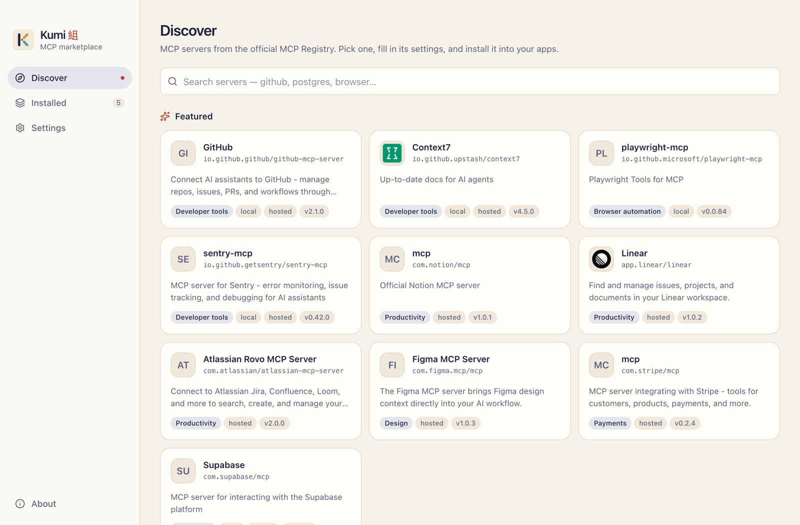
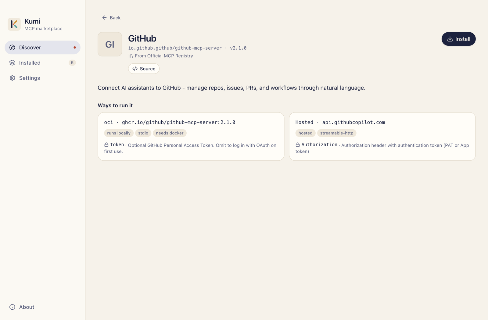
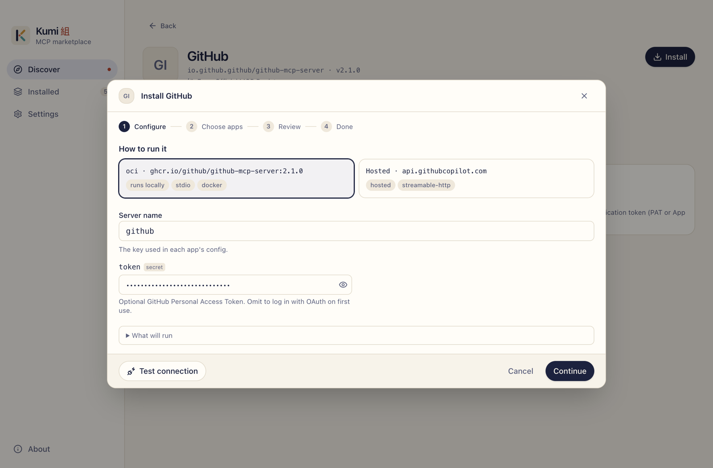
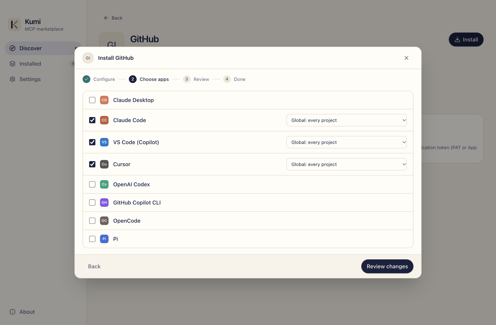
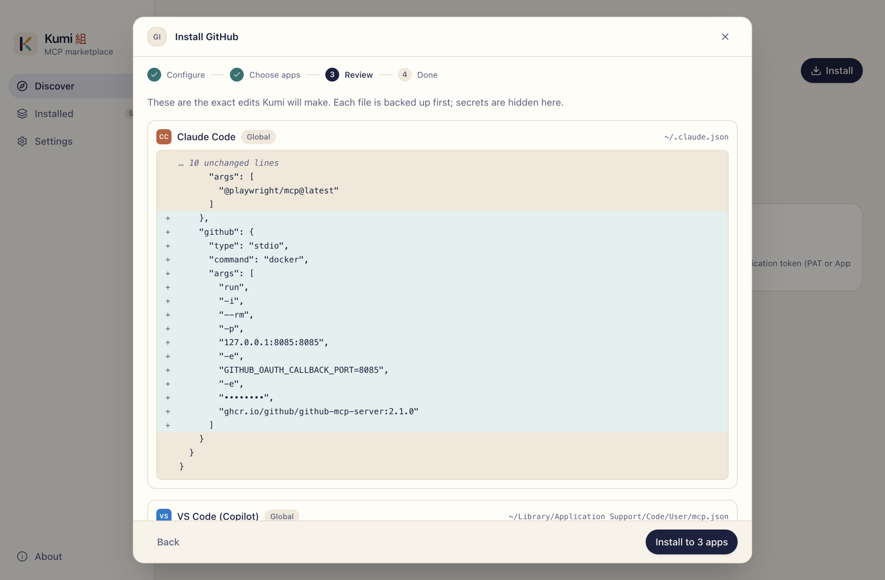
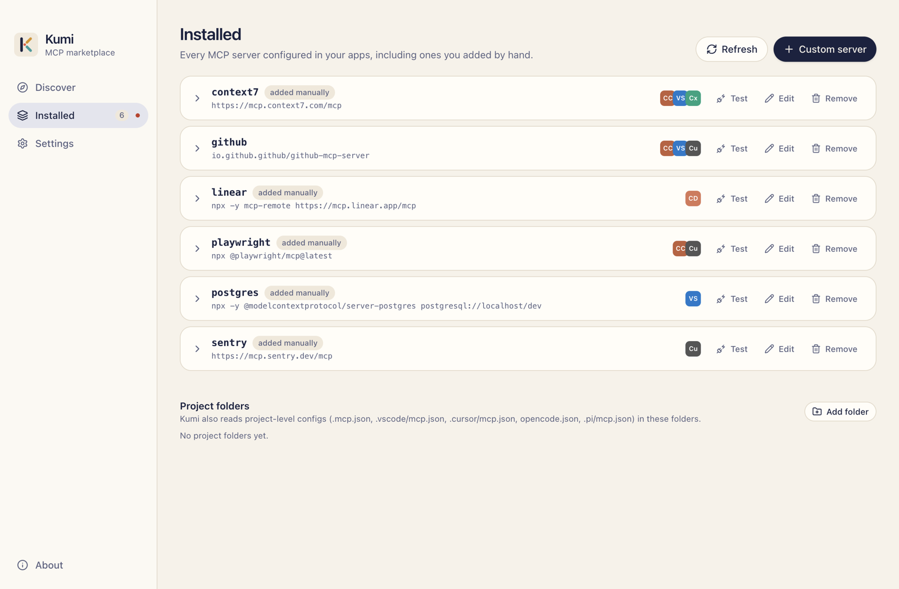
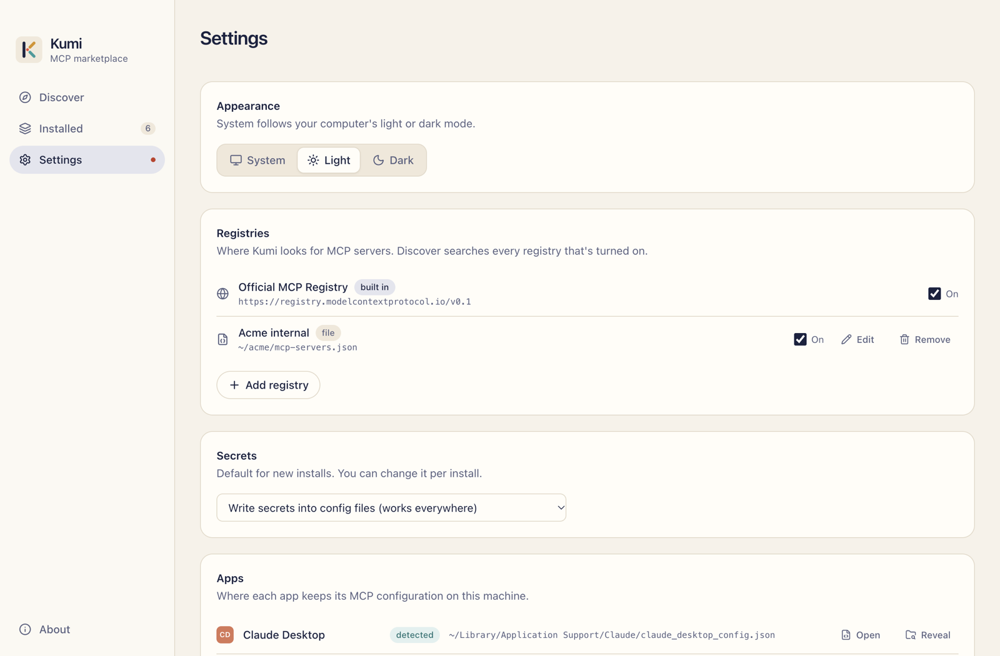
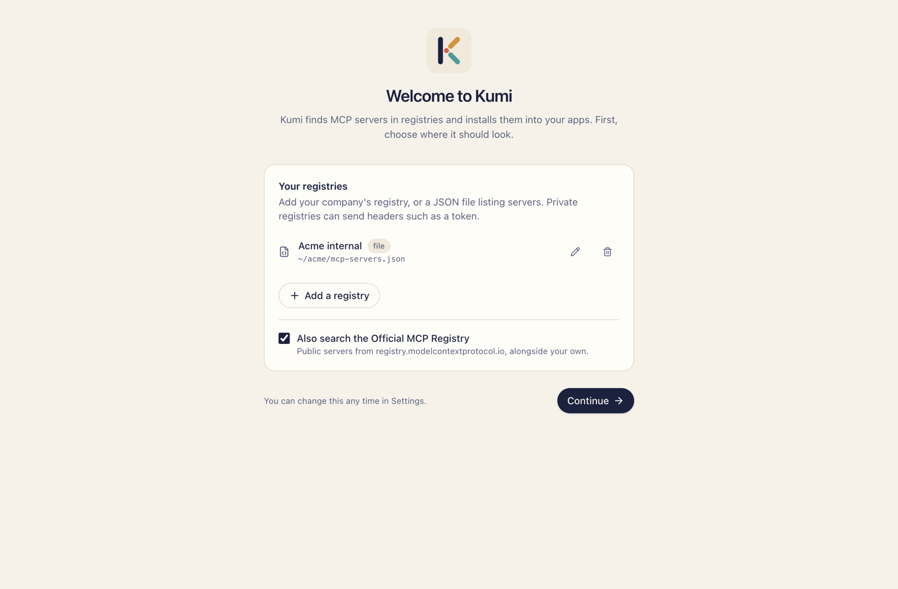
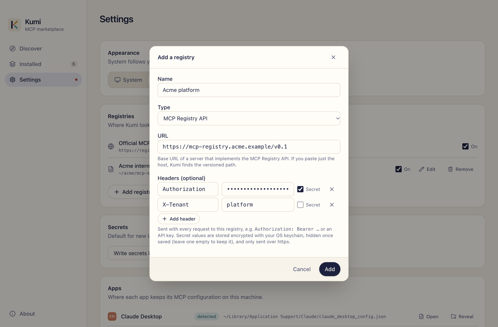

# Kumi

A desktop MCP marketplace. Browse MCP servers from the official [MCP Registry](https://registry.modelcontextprotocol.io) and your own registries, fill in their settings, and install them into the AI tools you use. Kumi writes the correct config, in the correct format and location, for each one.

| App | Scopes | Config |
|---|---|---|
| Claude Desktop | global | `claude_desktop_config.json` (remote servers via `mcp-remote`) |
| Claude Code | global, project (`.mcp.json`), local | `~/.claude.json` (honors `CLAUDE_CONFIG_DIR`) |
| VS Code (GitHub Copilot) | global, workspace (`.vscode/mcp.json`) | `mcp.json` (JSONC, optional secure `inputs`) |
| Cursor | global, project (`.cursor/mcp.json`) | `~/.cursor/mcp.json` |
| OpenAI Codex | global | `~/.codex/config.toml` (honors `CODEX_HOME`) |
| GitHub Copilot CLI | global | `~/.copilot/mcp-config.json` |
| OpenCode | global, project (`opencode.json`) | `~/.config/opencode/opencode.json` (SSE servers via `mcp-remote`) |
| Pi | global, project (`.pi/mcp.json`) | `~/.pi/agent/mcp.json` (honors `PI_CODING_AGENT_DIR`; SSE servers via `mcp-remote`) |

## Showcase

<picture>
  <source media="(prefers-color-scheme: dark)" srcset="docs/screenshots/discover-dark.png">
  
</picture>

<table>
  <tr>
    <td width="50%">
      <picture>
        <source media="(prefers-color-scheme: dark)" srcset="docs/screenshots/server-detail-dark.png">
        
      </picture>
      <p align="center"><b>Server detail</b>: every way to run a server and the settings it needs.</p>
    </td>
    <td width="50%">
      <picture>
        <source media="(prefers-color-scheme: dark)" srcset="docs/screenshots/install-configure-dark.png">
        
      </picture>
      <p align="center"><b>Configure</b>: a form generated from <code>server.json</code>, with secrets masked.</p>
    </td>
  </tr>
  <tr>
    <td width="50%">
      <picture>
        <source media="(prefers-color-scheme: dark)" srcset="docs/screenshots/install-targets-dark.png">
        
      </picture>
      <p align="center"><b>Choose apps</b>: install into several apps at once, per scope.</p>
    </td>
    <td width="50%">
      <picture>
        <source media="(prefers-color-scheme: dark)" srcset="docs/screenshots/install-review-dark.png">
        
      </picture>
      <p align="center"><b>Review</b>: the exact edit to each config file before anything is written.</p>
    </td>
  </tr>
  <tr>
    <td width="50%">
      <picture>
        <source media="(prefers-color-scheme: dark)" srcset="docs/screenshots/installed-dark.png">
        
      </picture>
      <p align="center"><b>Installed</b>: every server in every app, including ones added by hand.</p>
    </td>
    <td width="50%">
      <picture>
        <source media="(prefers-color-scheme: dark)" srcset="docs/screenshots/settings-dark.png">
        
      </picture>
      <p align="center"><b>Settings</b>: your registries, secrets default, and where each app keeps its config.</p>
    </td>
  </tr>
  <tr>
    <td width="50%">
      <picture>
        <source media="(prefers-color-scheme: dark)" srcset="docs/screenshots/welcome-dark.png">
        
      </picture>
      <p align="center"><b>Welcome</b>: on first run, add your own registries and choose whether to also search the official one.</p>
    </td>
    <td width="50%">
      <picture>
        <source media="(prefers-color-scheme: dark)" srcset="docs/screenshots/registry-headers-dark.png">
        
      </picture>
      <p align="center"><b>Private registries</b>: send headers such as a token; secret values are stored encrypted.</p>
    </td>
  </tr>
</table>

Screenshots follow your GitHub theme (light or dark).

## Features

- **Catalog**: search the official registry and your own at once, or filter to one; featured servers; offline cache.
- **Multiple registries**: add any server that implements the MCP Registry API, or a static JSON file (URL or local path) listing `server.json` entries. Private registries can send request headers (`Authorization: Bearer …`, an API key, a tenant id, …); secret ones are stored encrypted with the OS keychain. The official registry can be turned off.
- **Generated install forms**: env vars, arguments, headers and URL variables come from each server's `server.json`. Secrets are masked.
- **Preview before writing**: a per-file diff of the exact edit. Secrets are hidden in the preview.
- **Safe edits**: comments, key order and unrelated settings are preserved. Writes are atomic, each file is backed up before every change (one-click restore), and a write is refused if the file changed after the preview or if the edit would touch anything outside the server entry.
- **Ownership tracking**: Kumi only updates or removes entries it created, unless you confirm.
- **Installed view**: every server in every app, including ones added by hand. Edit, remove, or add to more apps.
- **Test connection**: starts the server (or connects to it), runs the MCP handshake, and lists its tools.
- **Secrets**: written into the config by default, or kept in VS Code's secure storage. Values Kumi keeps for later edits are encrypted with the OS keychain.

## Development

```bash
npm install
npm run dev        # run the app with hot reload
npm test           # unit + integration tests
npm run typecheck
npm run dist       # package installers with electron-builder
npm run icon       # regenerate build/icon.png and build/icon.icns from build/icon.svg
```

Kumi stores its state, backups and cache in `~/.kumi` (override with `KUMI_DATA_DIR`).

To try the app without touching your real configs, point it at a throwaway home:

```bash
env -u CLAUDE_CONFIG_DIR -u CODEX_HOME -u XDG_CONFIG_HOME -u PI_CODING_AGENT_DIR HOME=/tmp/kumi-home KUMI_DATA_DIR=/tmp/kumi-home/.kumi npm run dev
```

## Releasing

Releases are built by [`.github/workflows/release.yml`](.github/workflows/release.yml) when a version tag is pushed:

```bash
npm version minor          # or patch / major / 0.2.0-rc.1; commits and tags vX.Y.Z
git push --follow-tags
```

The workflow checks the tag matches `package.json`, runs the CI checks, packages macOS (dmg + zip, x64 and arm64), Windows (NSIS) and Linux (AppImage + deb), then publishes a GitHub release with generated notes. Tags with a suffix such as `-rc.1` become pre-releases.

Code signing is optional. Without these repository secrets the Windows installer is unsigned and the macOS app is ad-hoc signed (enough to run on Apple silicon, but not trusted by Gatekeeper):

| Secret | Purpose |
| --- | --- |
| `MAC_CSC_LINK`, `MAC_CSC_KEY_PASSWORD` | Developer ID Application certificate (`.p12`, base64) and its password |
| `APPLE_ID`, `APPLE_APP_SPECIFIC_PASSWORD`, `APPLE_TEAM_ID` | Notarization (needs the macOS certificate too) |
| `WIN_CSC_LINK`, `WIN_CSC_KEY_PASSWORD` | Windows code signing certificate (`.pfx`, base64) and its password |

To open an ad-hoc signed build after installing it, clear the quarantine flag:

```bash
xattr -dr com.apple.quarantine /Applications/Kumi.app
```

## Layout

```
src/shared/      types, registry schema, variant → ServerSpec resolution (used by both processes)
src/main/        Electron main: client adapters, config I/O (JSON/JSONC/TOML), install planner,
                 registry clients (API and static file), backups, state, health check, IPC
src/preload/     the narrow `window.kumi` bridge
src/renderer/    React UI
tests/           Vitest suites with real-world config and registry fixtures
```

See [PLAN.md](PLAN.md) for the design and roadmap.

## License

[MIT](LICENSE)
