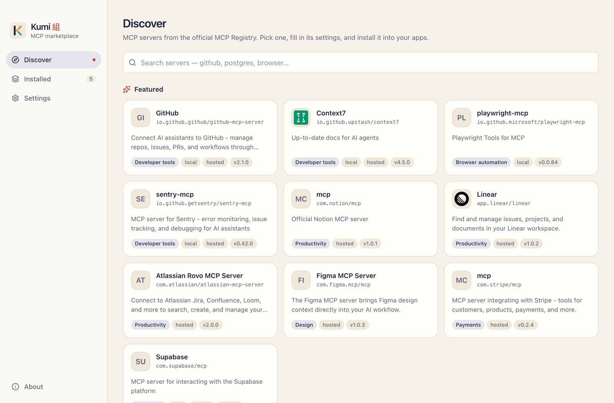
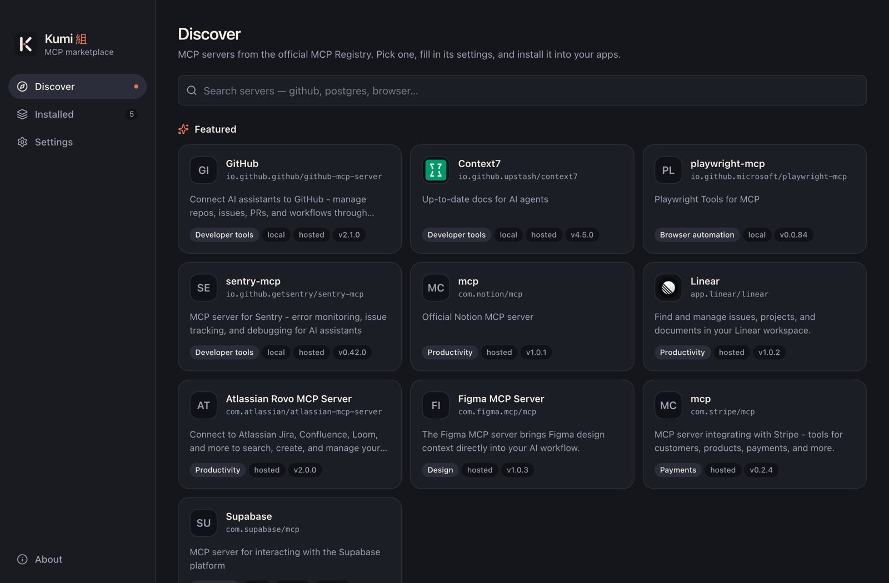
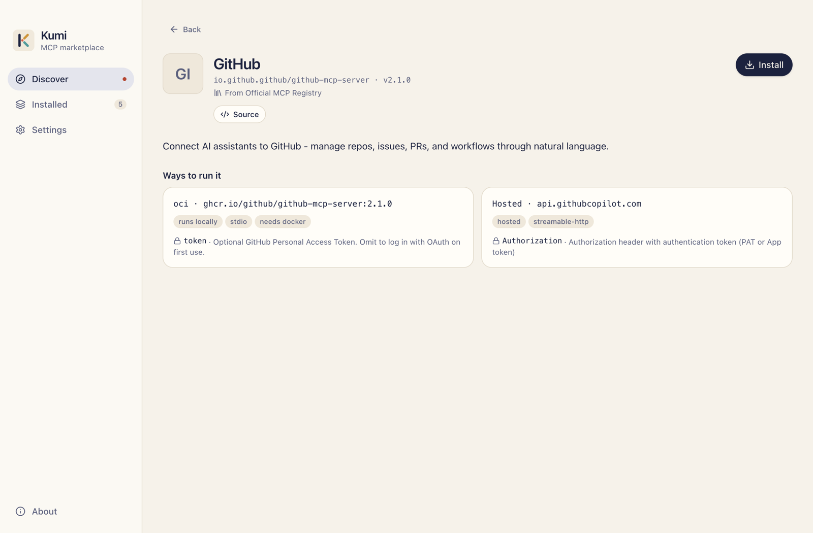
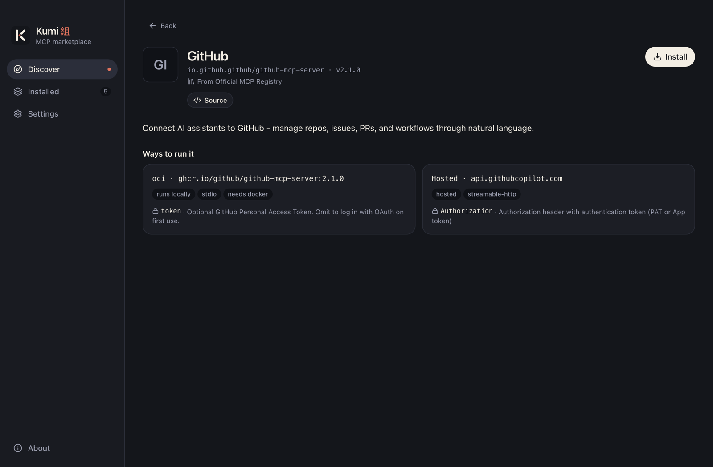

# Discover servers

**Discover** is where you find servers. It searches every registry that's turned on, all at once.

{.shot .light-only}
{.shot .dark-only}

## Search

Type in the search box to search by name, title and description. Results come from every enabled registry; servers from registries you added are listed first, because they are usually the ones you are looking for.

With more than one registry turned on, a **Registry** filter lets you search just one of them. Each card shows which registry the server came from.

If one registry can't be reached, Kumi still shows results from the others and tells you which one failed.

## Featured servers

With an empty search, Discover shows a short list of featured servers from the official registry, grouped by category: developer tools, browser automation, productivity, design, payments and databases.

## Server cards

Each card shows the server's name, description and badges:

- **local**: the server has packages you run on your machine (npm, PyPI, Docker, NuGet).
- **hosted**: the server has a remote endpoint you connect to over HTTP.
- A **category** for featured servers.

## Server detail

Click a card to open its detail page: description, version, links to its website and source repository, and the apps it's already installed in.

{.shot .light-only}
{.shot .dark-only}

### Ways to run it

Many servers can run in more than one way. Kumi lists each one as a **variant**:

| Variant | What runs | Needs |
|---|---|---|
| `npm · <package>@<version>` | `npx -y <package>@<version>` | Node.js |
| `pypi · <package>@<version>` | `uvx <package>@<version>` | uv |
| `oci · <image>` | `docker run -i --rm <image>` | Docker |
| `nuget · <package>@<version>` | `dnx <package>@<version> --yes` | .NET 10 SDK |
| `Hosted · <host>` | nothing local; your app connects to the URL | — |

Kumi pins the version the registry lists, so a server doesn't change under you. If a package names its own runtime (`runtimeHint`), Kumi uses that instead.

Each variant lists the settings it needs. A variant marked **not supported** can't be installed by Kumi yet, for example an `mcpb` package, or a package that runs as a local HTTP server.

Click **Install** to start the [install wizard](./install).

## Offline

Registry responses are cached on disk for ten minutes. If a registry can't be reached, Kumi falls back to the last copy it has, so you can keep browsing offline.
