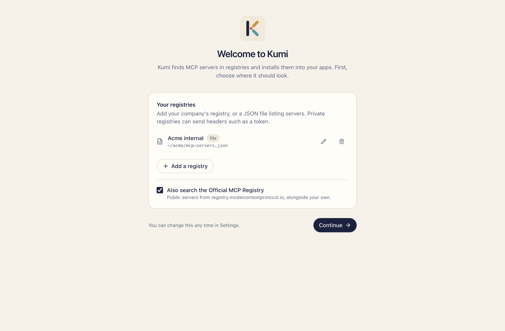
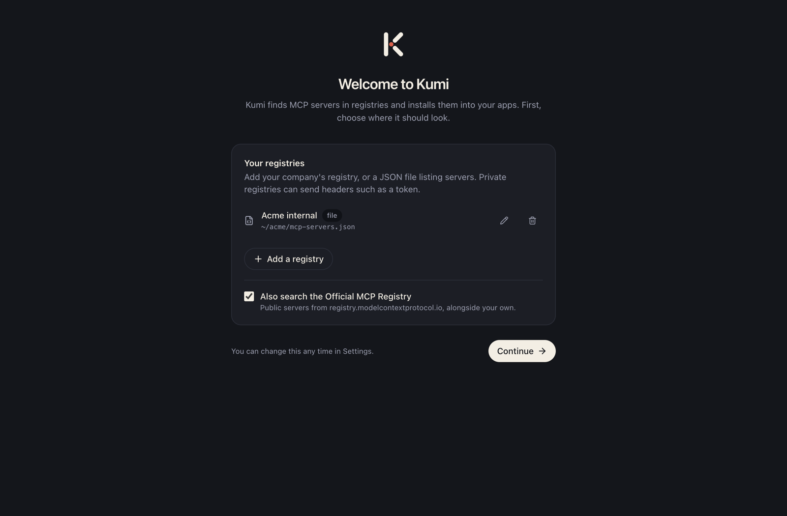

# First run

The first time you open Kumi, it asks where to look for MCP servers.

{.shot .light-only}
{.shot .dark-only}

## Choose your registries

You have two options:

- **Use the default registry.** Click **Use the default registry** and Kumi searches the [Official MCP Registry](https://registry.modelcontextprotocol.io), which lists public MCP servers. This is right for most people.
- **Add your own.** Click **Add a registry** to add your company's registry or a JSON file that lists servers. Private registries can send headers, such as a token. Once you've added one, a checkbox lets you choose whether to also search the official registry.

If you finish without any registries of your own, Kumi turns the official registry on, so there is always somewhere to search.

You can change all of this later in **Settings → Registries**. See [Registries](./registries) for the details.

## Find your apps

Kumi looks for the AI apps it supports and marks the ones it finds as *detected*. An app counts as detected when its command is on your `PATH` (for example `claude`, `code`, `cursor`, `codex`, `copilot`, `opencode`, `pi`) or its config folder exists.

**Settings → Apps** shows what was found and where each app keeps its MCP configuration. You can still install into an app Kumi didn't detect; it creates the config file.

## Servers you already have

Kumi reads the config files of every supported app, so servers you set up by hand show up in **Installed** right away, marked *added manually*. Kumi won't change or remove them without asking. See [Manage installed servers](./installed).

## Next

[Discover servers →](./discover)
