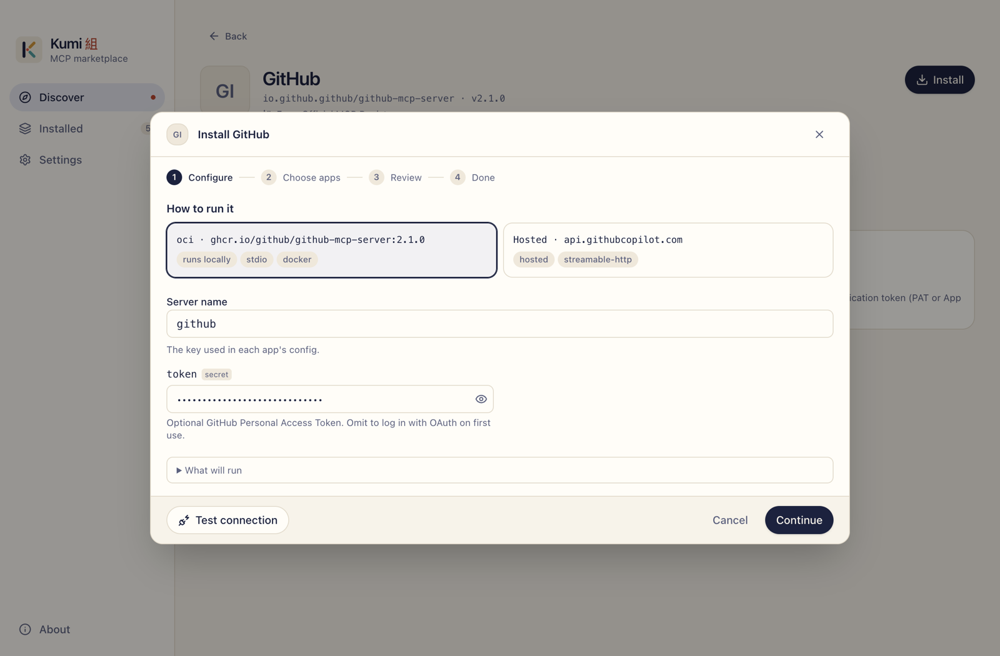
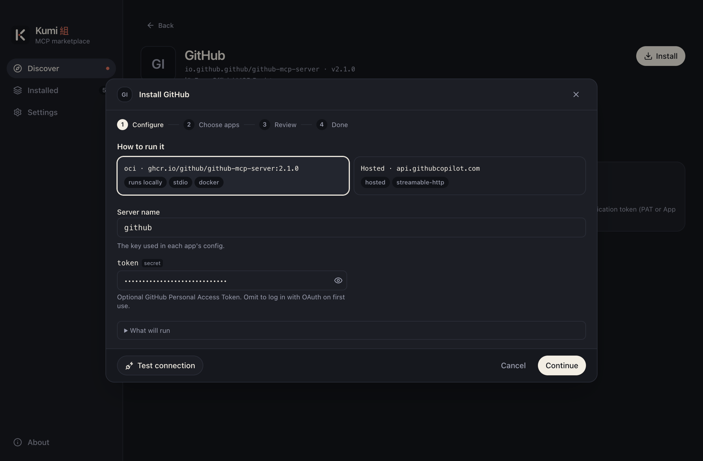
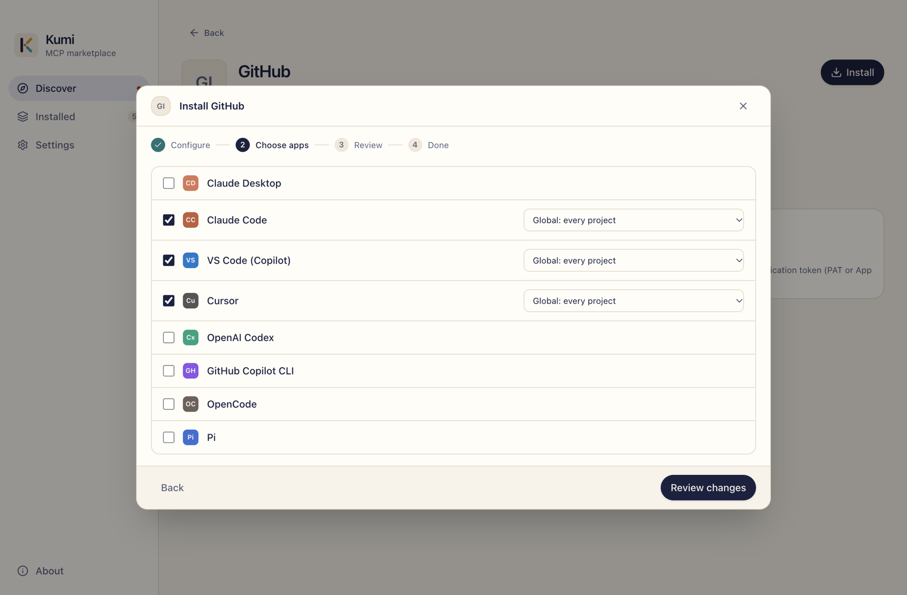
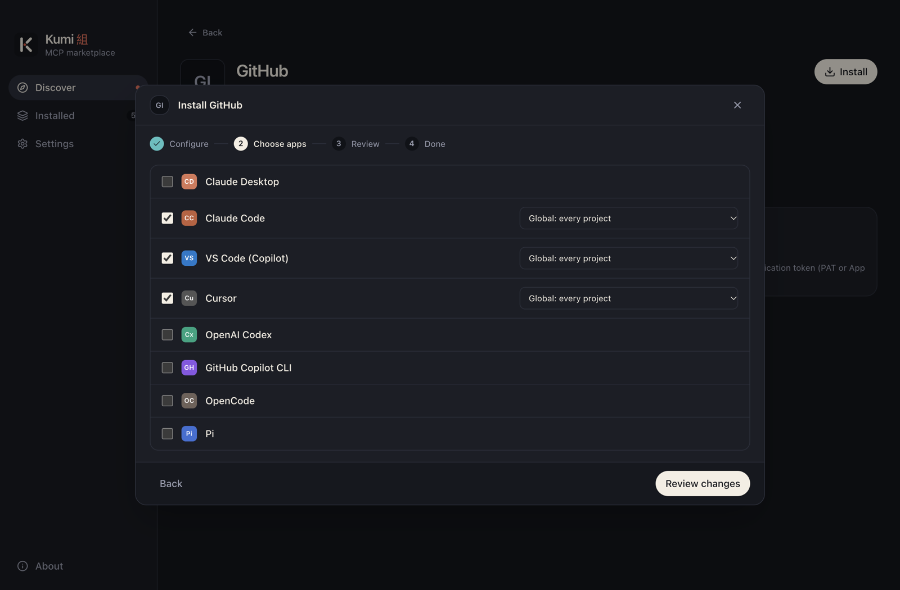
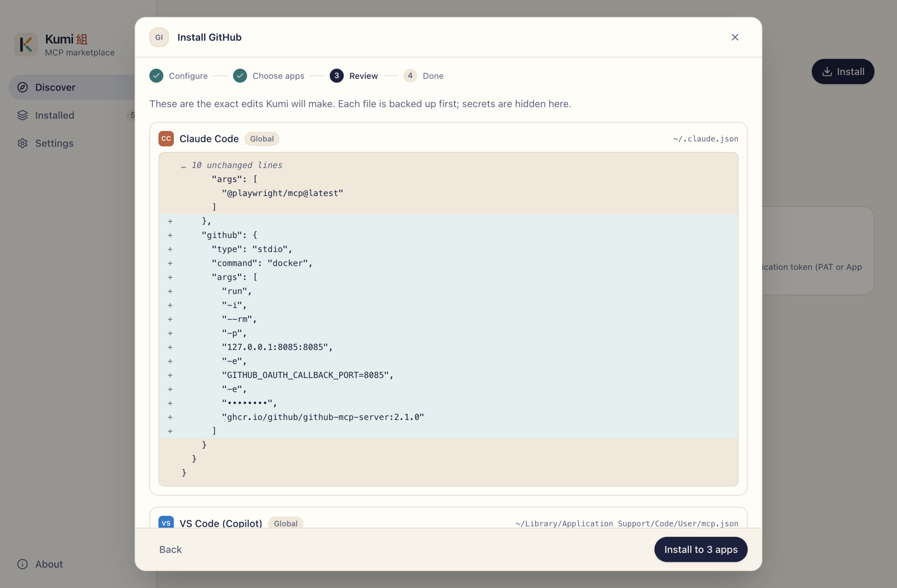
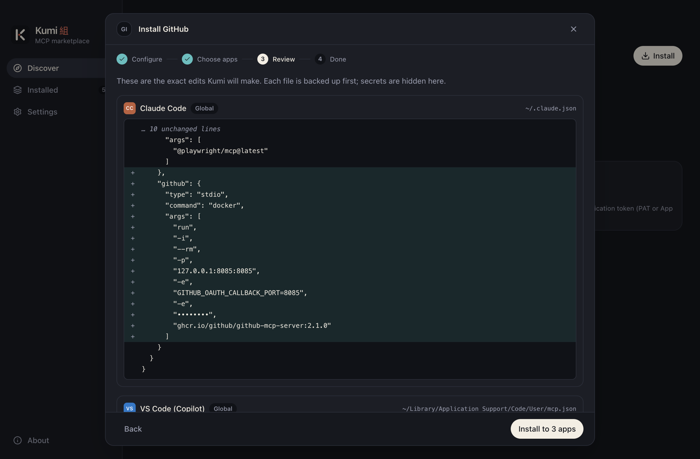

# Install a server

Click **Install** on a server's detail page to open the install wizard. It has four steps: **Configure**, **Choose apps**, **Review** and **Done**. Nothing is written until you click **Install** on the review step.

## 1. Configure

{.shot .light-only}
{.shot .dark-only}

### How to run it

If the server has more than one [variant](./discover#ways-to-run-it), pick one. Each is marked **runs locally** or **hosted**. Kumi preselects the first one it can install.

If a local variant needs a runtime that isn't on your machine, such as `npx` or `uvx`, Kumi warns you and links to how to install it. You can still go ahead; the server just won't start until the runtime is there.

### Server name

The key the server is saved under in each app's config, for example `github`. Kumi suggests a short name from the registry name (`io.github.github/github-mcp-server` becomes `github`). Names can contain letters, digits, `-` and `_`.

### Settings

The form is built from the server's `server.json`:

| Group | Comes from |
|---|---|
| Environment variables | `packages[].environmentVariables` |
| Arguments | `packages[].runtimeArguments` and `packageArguments` |
| Headers | `remotes[].headers` |
| URL variables | `{placeholders}` in a remote's URL |

Fields keep the registry's descriptions, defaults, choices and required flags. Secret fields are masked. Repeated arguments take one value per line.

Open **What will run** to see the exact command or URL that the apps will use, with secrets masked.

You can click **Test connection** at this point to [check that the server starts](./test-connection) before you install it anywhere.

## 2. Choose apps

{.shot .light-only}
{.shot .dark-only}

Tick every app you want the server in. Apps Kumi didn't detect are marked **not detected**, but you can still choose them.

### Scopes

For each app, pick where the server goes:

| Scope | Meaning | Apps |
|---|---|---|
| **Global** | Every project. Saved in your user config. | all |
| **Project** | Saved in the repo (for example `.mcp.json`), so it's shared with your team. | Claude Code, VS Code, Cursor, OpenCode, Pi |
| **Local** | This project, only for you. Saved in your user config under the project's path. | Claude Code |

Project and Local need a folder: click **Choose folder…**. Kumi remembers the folders you use and reads their configs in [Installed](./installed).

### Compatibility

Not every app can reach every kind of server. When an app can't connect to a remote server from its config file, Kumi runs it through [`mcp-remote`](https://www.npmjs.com/package/mcp-remote), a small stdio bridge, and marks the app **via mcp-remote**. This needs Node.js. An app that can't use the server at all is marked **not supported**. See [Supported apps](../reference/apps#transports) for the full matrix.

### Secrets

If the server has secret settings, choose where they go:

- **Write into config files**: works in every app. Values are stored in plain text, the same as setting it up by hand.
- **Use the app's secure storage**: VS Code asks for each secret once and keeps it in its own secret storage. Other apps fall back to config files.

The default comes from **Settings → Secrets**. See [Secrets](./secrets).

## 3. Review

{.shot .light-only}
{.shot .dark-only}

Kumi shows the exact edit it will make to each config file, as a diff. Secrets are hidden. Each file is backed up before it's written.

Each change may carry notes:

- **replaces existing**: a server with this name is already in that config.
- A reminder to restart the app (Claude Desktop reloads its config only on restart).
- A warning when a command isn't installed, a server is bridged through `mcp-remote`, or an app has no secure storage for secrets.

If a server with the same name is already in a config and Kumi didn't put it there, that app is blocked. Go back and pick another name, or tick **Replace existing servers with the same name that Kumi didn't install**.

Click **Install** to write the files.

::: tip The preview is the contract
If a config file changes between the preview and the write (say, an app saved it in the meantime), Kumi refuses to write it and asks you to review again. A preview expires after 30 minutes.
:::

## 4. Done

Kumi lists the result for each app, the backup it took, and anything you need to do next, such as restarting Claude Desktop. From here you can **Test connection** or go to **View installed**.

## Editing an install

To change a server's settings later, click **Edit** on it in [Installed](./installed). The wizard reopens with your previous values, secrets included if the OS keychain is available, and the apps it's installed in. The server name can't be changed while editing.
