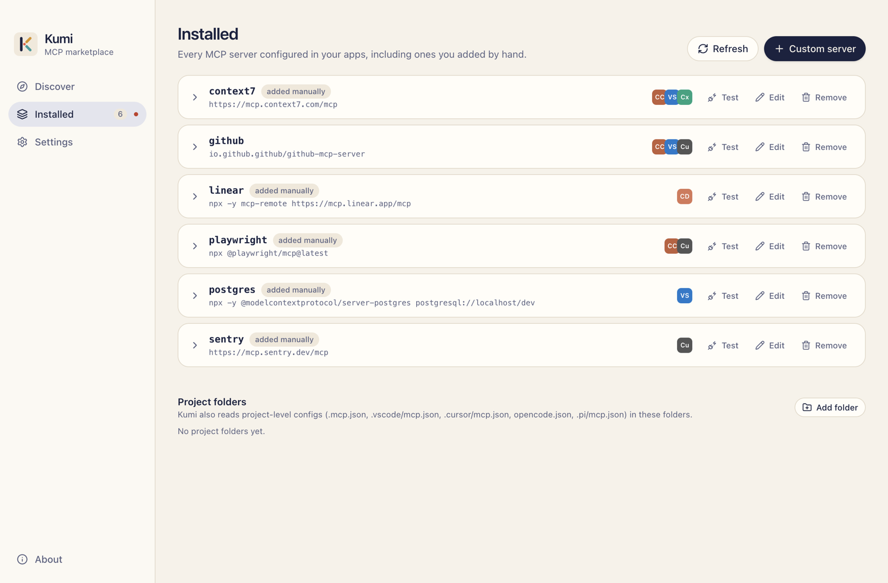
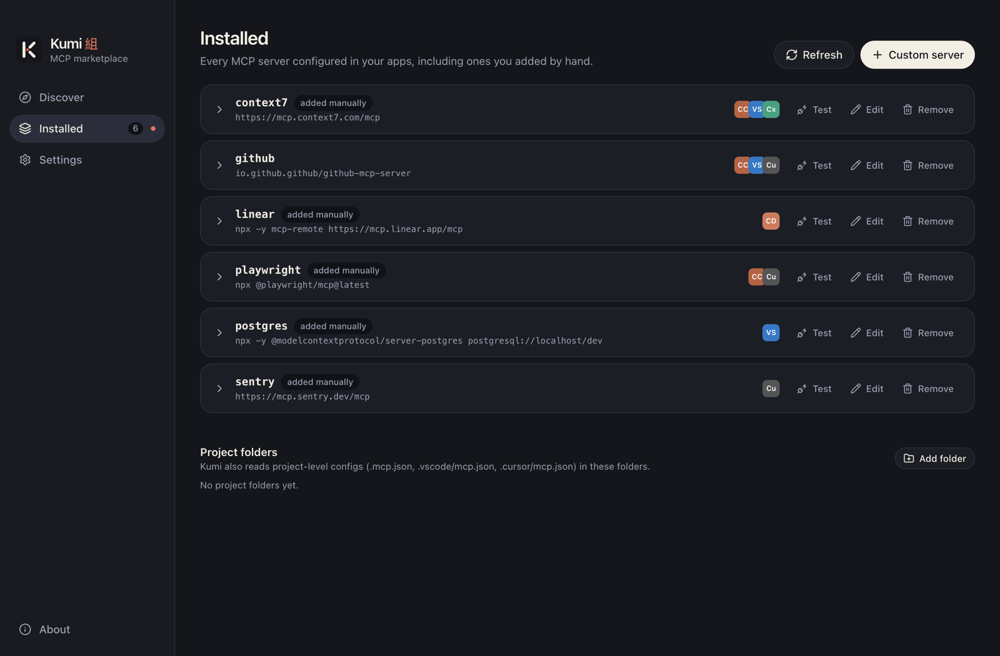

# Manage installed servers

**Installed** lists every MCP server configured in your apps, including the ones you added by hand.

{.shot .light-only}
{.shot .dark-only}

## How it's built

Kumi reads the config file of every supported app, for the global scope and for every project folder it knows about, and groups the entries by server name. It reads the files each time, so the list is always what's actually on disk.

Each server is marked:

| Badge | Meaning |
|---|---|
| **managed** | Kumi installed it everywhere it appears. |
| **partly managed** | Kumi installed it in some places; others were added by hand. |
| **added manually** | Kumi didn't install it anywhere. |

Expand a server to see each app and scope it's in, with its own **manual** or **managed** mark.

If a config file can't be read (for example, it isn't valid JSON), Kumi shows the error and leaves the file alone.

## Actions

On a server:

- **Test connection**: start it and list its tools. See [Test a connection](./test-connection).
- **Edit**: reopen the [install wizard](./install#editing-an-install) with the current settings. You can change values, or add the server to more apps.
- **Remove**: remove it from every app it's in.

On each app entry:

- **Config**: open the config file in your default editor.
- **Remove**: remove it from just that config.

Editing a server you added by hand adopts it: from then on, Kumi manages it.

::: warning Servers Kumi didn't install
Kumi asks before removing or replacing an entry it didn't create. A backup is taken either way, so you can [restore it](#backups).
:::

## Project folders

Project-scoped servers live in the project, so Kumi needs to know which folders to look in. Every folder you pick in the install wizard is remembered. You can also add folders with **Add folder** under **Project folders**, at the bottom of the page, or stop tracking one with its **×** button.

In each folder, Kumi reads:

| File | App |
|---|---|
| `.mcp.json` | Claude Code (project scope) |
| `.vscode/mcp.json` | VS Code (workspace) |
| `.cursor/mcp.json` | Cursor |
| `opencode.json` | OpenCode |
| `.pi/mcp.json` | Pi |

It also reads the folder's block in `~/.claude.json` for Claude Code's local scope.

Removing a folder from the list only stops Kumi from reading it. Nothing in the folder changes.

## Backups

Before every write, Kumi copies the config file. **Settings → Backups** lists them, newest first. Click **Restore** to put a file back the way it was. Restoring also backs up the current file first, so a restore can be undone.

If Kumi created a file that didn't exist before, its backup is marked *didn't exist*, and restoring it deletes the file.

Kumi keeps the last 20 backups of each file. See [Data directory](../reference/data-directory) for where they're stored.
