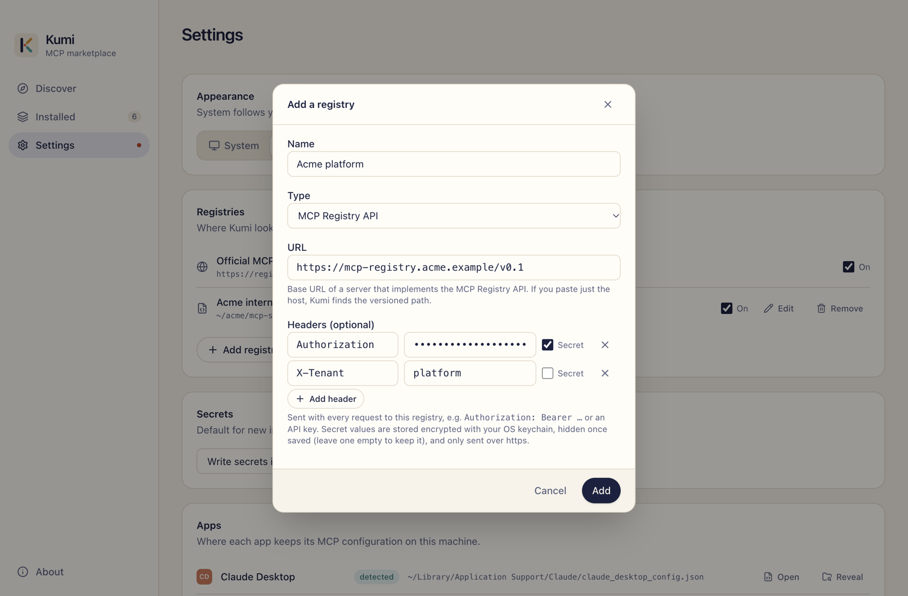
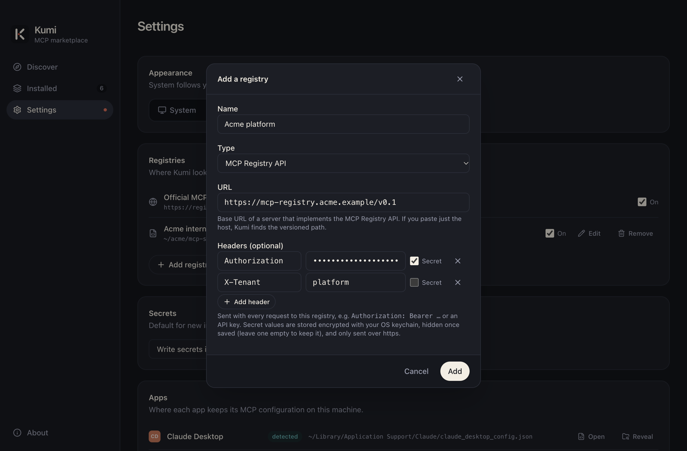

# Registries

A registry is where Kumi finds servers. Kumi ships with the [Official MCP Registry](https://registry.modelcontextprotocol.io), and you can add your own: a company registry, a private catalog, or a JSON file on disk.

Manage them in **Settings → Registries**, or on the [first-run screen](./first-run).

## Kinds of registry

| Kind | What it is | Location |
|---|---|---|
| **MCP Registry API** | A server that implements the [MCP Registry API](https://registry.modelcontextprotocol.io/docs), like the official one. Search and paging happen on the server. | Base URL, for example `https://registry.example.com/v0.1` |
| **Static JSON file** | One JSON file that lists `server.json` entries. Kumi loads it and searches it locally. | An `https` URL, or an absolute path on disk |

### MCP Registry API

Enter the registry's base URL. If you paste just the host (`https://registry.example.com`), Kumi tries `/v0.1` and `/v0` and saves the one that answers.

Kumi uses two endpoints:

```http
GET <base>/servers?limit=30&version=latest&search=<query>&cursor=<cursor>
GET <base>/servers/<name>/versions/<version>
```

Servers whose registry status isn't `active` (for example `deprecated` or `deleted`) are hidden.

### Static JSON file

A static file is the simplest way to publish a private catalog: commit it to a repo, host it anywhere, or keep it on a shared drive. See [Registry file format](../reference/registry-format).

A local file is re-read whenever it changes on disk, so you can edit it and see the result right away.

## Adding a registry

Click **Add a registry**, give it a name, pick the kind and enter the location. Kumi checks that the registry answers before saving it, so a typo or a missing token shows up right away.

{.shot .light-only}
{.shot .dark-only}

## Headers

Private registries usually want credentials. Add any request headers the registry needs, for example:

| Header | Example |
|---|---|
| `Authorization` | `Bearer <token>` |
| `X-API-Key` | `<key>` |
| `X-Tenant` | `acme` |

Each header is **secret** or plain:

- **Secret** values are encrypted with the OS keychain (Keychain on macOS, DPAPI on Windows, the Secret Service or kwallet on Linux) and never shown again. To keep a saved secret when editing, leave its value empty (**Keep saved value**). To change it, type a new one.
- **Plain** values are stored and shown as they are.

Rules Kumi enforces:

- Secret headers are only sent over `https` (plain `http` is allowed for `localhost`).
- A header can only appear once, and its value must be a single line.
- Headers that belong to the HTTP connection itself (`Host`, `Content-Length`, `Connection` and similar) can't be set.
- If the keychain isn't available, Kumi refuses to save secret headers rather than storing them in plain text.

## Turning registries on and off

Each registry has a switch. Discover only searches the ones that are on.

The official registry can be turned off, but not edited or removed. Registries you add can be edited and removed.

Servers you installed from a registry stay editable even after you turn that registry off. If you remove it, Kumi asks you to add it again before you can edit those servers.

## Offline and failures

Responses are cached on disk for ten minutes and reused when a registry can't be reached. When one of several registries fails, Discover shows the results from the others and names the one that failed. Requests time out after 25 seconds, because the official registry can be slow to answer.
