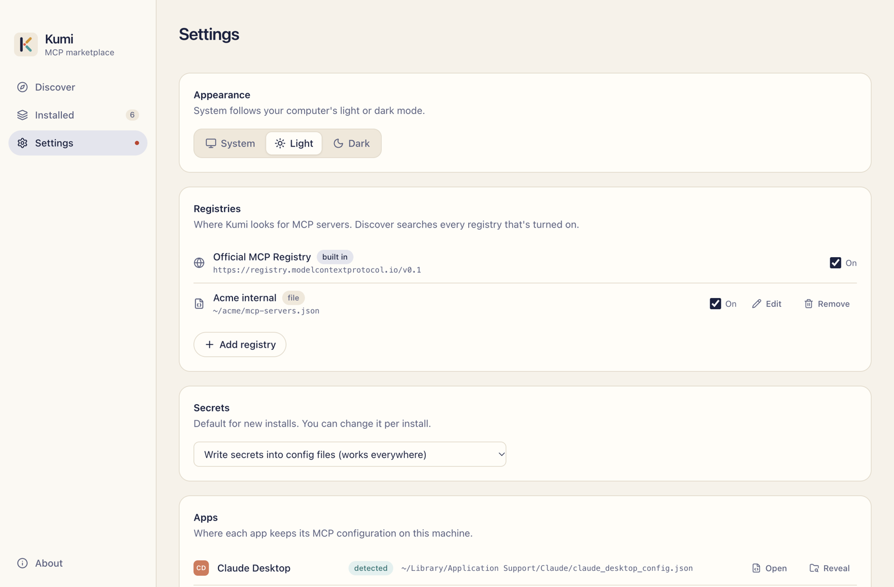
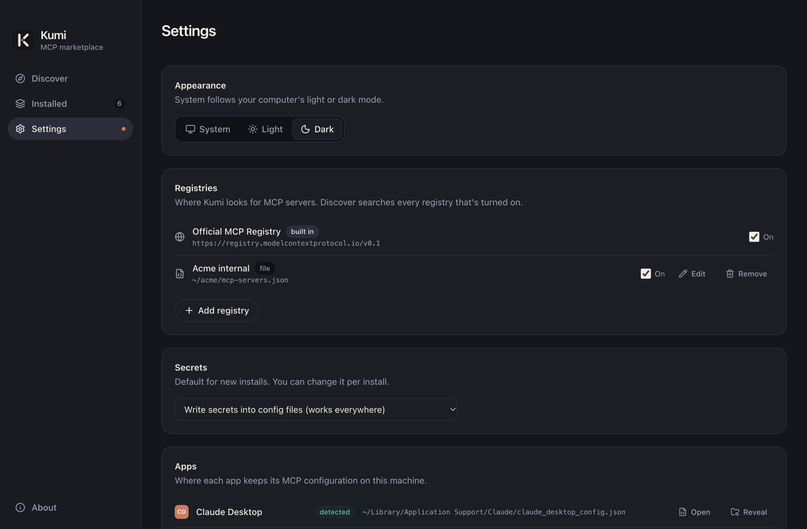

# Settings

{.shot .light-only}
{.shot .dark-only}

## Appearance

**Theme**: System, Light or Dark. System follows your computer's light or dark mode.

## Registries

Where Kumi looks for MCP servers. Discover searches every registry that's turned on. Add, edit, remove and turn registries on and off. See [Registries](./registries).

## Private networks

Hosts that are only reachable on a VPN or office network. A server whose host matches gets a **private network** badge, a note in the install wizard, and a specific hint when a test can't reach it. See [Servers on a private network](./test-connection#servers-on-a-private-network).

- **Include names and ranges that can only be private**: on by default. Names without a dot (`http://mcp:8080`, but not `localhost`), `*.internal`, `*.local`, `*.home.arpa`, and the private IP ranges `10.0.0.0/8`, `172.16.0.0/12`, `192.168.0.0/16`, `100.64.0.0/10` and `fc00::/7`.
- **Your patterns**: a host (`mcp.acme.com`), every host under a domain (`*.acme.com`, which doesn't match `acme.com` itself), or an IP address or range (`10.42.0.0/16`, `fd12::/16`). Each can have a **VPN name**, used in messages: "connect to Acme GlobalProtect". Your patterns are checked before the built-in ones.
- **Check a URL**: type a URL or host to see which pattern matches it.

An IP range matches when the URL has an IP in it. For a name, Kumi only looks up its address after a test times out, to see whether it points into one of the ranges.

## Secrets

The default secrets mode for new installs. You can still change it per install. See [Secrets](./secrets).

- **Write secrets into config files** (works everywhere)
- **Use the app's secure storage where available** (VS Code)

## Apps

Every app Kumi supports, whether it was detected on this machine, and where it keeps its global MCP config. **Open** opens the file in your default editor; the folder button shows it in Finder or Explorer. See [Supported apps](../reference/apps).

## Runtimes

The programs local MCP servers need (`npx`, `uvx`, `docker`, `dnx`), where Kumi found each one, and how to install the missing ones.

## Backups

Every config file Kumi has changed, with a copy from right before each change. Restore puts the file back; the current file is backed up first. See [Backups](./installed#backups).

## About

The **About** page shows Kumi's version, the Electron, Chromium and Node.js versions it runs on, your platform, and Kumi's [data directory](../reference/data-directory).
