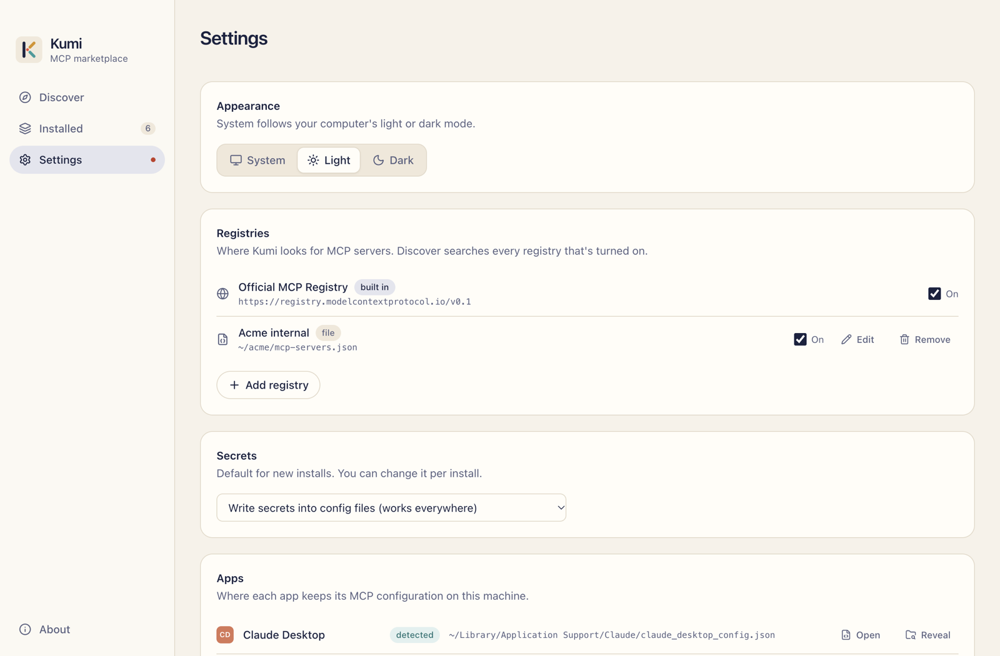
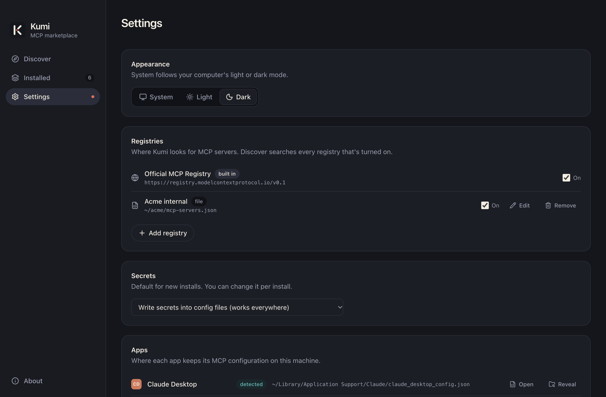

# Settings

{.shot .light-only}
{.shot .dark-only}

## Appearance

**Theme**: System, Light or Dark. System follows your computer's light or dark mode.

## Registries

Where Kumi looks for MCP servers. Discover searches every registry that's turned on. Add, edit, remove and turn registries on and off. See [Registries](./registries).

## Secrets

The default secrets mode for new installs. You can still change it per install. See [Secrets](./secrets).

- **Write secrets into config files** (works everywhere)
- **Use the app's secure storage where available** (VS Code)

## Apps

Every app Kumi supports, whether it was detected on this machine, and where it keeps its global MCP config. **Open** opens the file in your default editor; the folder button shows it in Finder or Explorer. See [Supported apps](../reference/apps).

## Runtimes

The programs local MCP servers need (`npx`, `uvx`, `docker`, `dnx`), where Kumi found each one, and how to install the missing ones.

## Backups

Every config file Kumi has changed, with a copy from right before each change. Restore puts the file back; the current file is backed up first. See [Backups](./installed#backups).

## About

The **About** page shows Kumi's version, the Electron, Chromium and Node.js versions it runs on, your platform, and Kumi's [data directory](../reference/data-directory).
